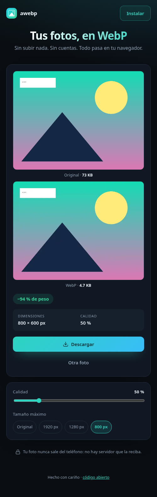

# awebp

Convierte tus fotos a WebP en un toque, **sin subirlas a ningún lado**.

**https://synapse-ve.github.io/awebp/**

[](https://github.com/Synapse-VE/awebp/actions/workflows/ci.yml)
[](https://github.com/Synapse-VE/awebp/actions/workflows/deploy.yml)
[](LICENSE)



## Qué hace

- Tomas una foto con la cámara del teléfono (o eliges una de la galería) y sale en WebP.
- Muestra cuánto pesaba y cuánto pesa, con el porcentaje de ahorro.
- Deja ajustar la calidad (40–95 %) y el tamaño máximo (original, 1920, 1280 u 800 px).
- Se puede instalar como app (PWA) y funciona sin conexión después de la primera visita.
- En escritorio también acepta arrastrar y soltar, o pegar con `Ctrl` + `V`.

No hay servidor: **la foto nunca sale del teléfono**. Se puede comprobar en DevTools — no hay ningún request con la imagen.

## Cómo funciona

```
archivo → createImageBitmap (aplica EXIF) → canvas → resize → encode → Blob
```

El encode prueba tres caminos en orden: `OffscreenCanvas.convertToBlob`, `canvas.toBlob` con
límite de tiempo y `toDataURL`. Si ninguno devuelve `image/webp` de verdad, cae a
**libwebp compilado a WebAssembly**.

### El detalle de Safari

Safari (y todo iOS) **no sabe codificar WebP** con el canvas: si le pides WebP, devuelve un PNG
con la extensión cambiada, sin avisar. Por eso no alcanza con mirar el `blob.type` de la
primera llamada: hay que verificar y tener un plan B.

Ese plan B es `vendor/webp/`, el encoder de [jSquash](https://github.com/jamsinclair/jSquash)
(libwebp + Emscripten, Apache-2.0) vendorizado para no depender de un CDN. Se descarga solo
cuando hace falta y queda cacheado por el service worker.

## Desarrollo

Sin dependencias ni build: HTML, CSS y módulos ES.

```console
$ npm run serve   # http://localhost:8080
$ npm test        # lógica pura con node:test
```

Prueba de punta a punta (necesita Google Chrome):

```console
$ node tools/e2e.mjs mobile            # sube una foto por el input
$ node tools/e2e.mjs mobile wasm       # fuerza el camino WebAssembly
$ node tools/e2e.mjs mobile drop       # arrastrar y soltar
$ node tools/e2e.mjs mobile paste      # pegar del portapapeles
$ node tools/e2e.mjs mobile input offline   # recarga sin servidor (PWA)
$ node tools/e2e.mjs desktop           # captura de escritorio
```

Las capturas quedan en `.shots/`.

## Estructura

```
index.html            estructura y textos
css/estilos.css       estilos (mobile first, tema oscuro)
js/app.js             cableado de la interfaz y estado
js/convertir.js       pipeline: decodificar, redimensionar, codificar
js/reglas.js          validaciones y tamaños (testeable sin DOM)
js/formato.js         bytes legibles, nombres y porcentajes
vendor/webp/          encoder WebAssembly (terceros, Apache-2.0)
icons/                iconos de la PWA generados con Pillow
sw.js                 service worker
tools/                generador de iconos y pruebas E2E
```

## Pendientes

- HEIC en navegadores que no lo decodifican (Chrome/Android): hoy se muestra un mensaje claro.
- Multi-archivo.
- Compartir desde la galería del teléfono (share target).

## Créditos

El encoder WebP es de [jSquash](https://github.com/jamsinclair/jSquash), reempaquetado de
Squoosh (Google), bajo Apache-2.0. Ver `vendor/webp/LICENSE`.

## Licencia

MIT.
