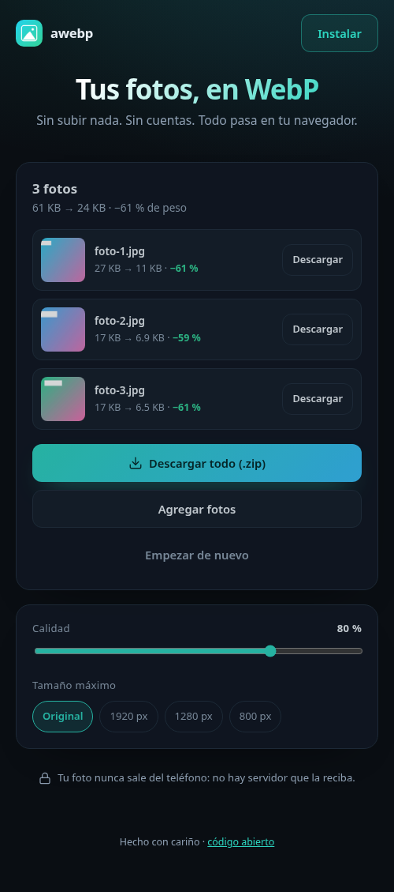

# awebp

Convierte tus fotos a WebP en un toque, **sin subirlas a ningún lado**.

**https://synapse-ve.github.io/awebp/**

[](https://github.com/Synapse-VE/awebp/actions/workflows/ci.yml)
[](https://github.com/Synapse-VE/awebp/actions/workflows/deploy.yml)
[](LICENSE)




## Qué hace

- Tomas una foto con la cámara del teléfono (o eliges varias de la galería) y salen en WebP.
- Acepta **JPG, PNG, WebP, AVIF y HEIC** (este último también en Android/Chrome, donde el
  navegador no lo abre solo).
- Muestra cuánto pesaba y cuánto pesa, con el porcentaje de ahorro por foto y en total.
- Deja ajustar la calidad (40–95 %) y el tamaño máximo (original, 1920, 1280 u 800 px).
- Hasta 10 fotos por tanda, con descarga individual o **todo en un ZIP**.
- Se puede instalar como app (PWA), funciona **sin conexión** y en Android acepta
  **compartir fotos desde la galería** directamente a awebp.
- En escritorio también acepta arrastrar y soltar, o pegar con `Ctrl` + `V`.

No hay servidor: **la foto nunca sale del teléfono**. Se puede comprobar en DevTools — no hay ningún request con la imagen.

## Cómo funciona

```
archivo → decodificar (nativo o wasm) → canvas → resize → encode → Blob
```

El **encode** prueba tres caminos en orden: `OffscreenCanvas.convertToBlob`,
`canvas.toBlob` con límite de tiempo y `toDataURL`. Si ninguno devuelve `image/webp`
de verdad, cae a **libwebp compilado a WebAssembly**.

El **decode** intenta primero lo nativo (`createImageBitmap`, ``). Si el navegador no
puede y la cabecera ISO-BMFF dice HEIC/HEIF, usa **libheif en WebAssembly** y arma una vista
previa JPEG (el navegador tampoco puede pintar un HEIC).

### El detalle de Safari

Safari (y todo iOS) **no sabe codificar WebP** con el canvas: si le pides WebP, devuelve un PNG
con la extensión cambiada, sin avisar. Por eso no alcanza con mirar el `blob.type` de la
primera llamada: hay que verificar y tener un plan B.

Ese plan B es `vendor/webp/`, el encoder de [jSquash](https://github.com/jamsinclair/jSquash)
(libwebp + Emscripten, Apache-2.0) vendorizado para no depender de un CDN. Se descarga solo
cuando hace falta y queda cacheado por el service worker.

## Desarrollo

Sin dependencias ni build: HTML, CSS y módulos ES.

```console
$ npm run serve   # http://localhost:8080
$ npm test        # lógica pura con node:test
```

Prueba de punta a punta (necesita Google Chrome):

```console
$ node tools/e2e.mjs mobile             # sube una foto por el input
$ node tools/e2e.mjs mobile wasm        # fuerza el camino WebAssembly
$ node tools/e2e.mjs mobile heic        # archivo HEIC real
$ node tools/e2e.mjs mobile drop        # arrastrar y soltar
$ node tools/e2e.mjs mobile paste       # pegar del portapapeles
$ node tools/e2e.mjs mobile multi       # tres fotos + zip descargado
$ node tools/e2e.mjs mobile share       # POST de share target y recogida
$ node tools/e2e.mjs mobile input offline   # recarga sin servidor (PWA)
$ node tools/e2e.mjs desktop            # captura de escritorio
```

Con `AWEBP_URL=https://synapse-ve.github.io/awebp/` la misma prueba corre contra el sitio publicado.

## Estructura

```
index.html            estructura y textos
css/estilos.css       estilos (mobile first, tema oscuro)
js/app.js             cableado de la interfaz y estado (una o varias fotos)
js/convertir.js       pipeline: decodificar, redimensionar, codificar
js/reglas.js          validaciones, tamaños y detección de HEIC (testeable sin DOM)
js/formato.js         bytes legibles, nombres y porcentajes
js/zip.js             escritor de ZIP (store + CRC32)
vendor/webp/          encoder WebAssembly (jSquash, Apache-2.0)
vendor/heic/          lector HEIC WebAssembly (libheif, LGPL-3.0)
icons/                iconos de la PWA generados con Pillow
sw.js                 service worker (cache + share target)
tools/                generador de iconos y pruebas E2E
```

## Pendientes

- Compartir desde iOS: Safari no implementa `share_target` (el botón Descargar/Compartir sí anda).
- Ordenar o borrar fotos de la lista antes de descargar.
- Recordar la última configuración de calidad y tamaño.

## Créditos

- Encoder WebP: [jSquash](https://github.com/jamsinclair/jSquash), reempaquetado de Squoosh
  (Google), Apache-2.0. Ver `vendor/webp/LICENSE`.
- Lector HEIC: [libheif-js](https://github.com/strukturag/libheif), LGPL-3.0.
  Ver `vendor/heic/LICENSE`.

## Licencia

MIT.
